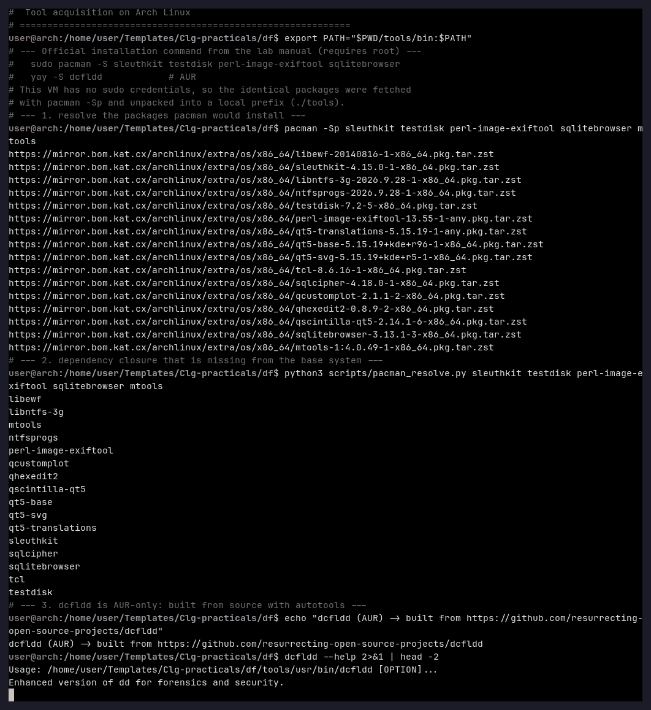
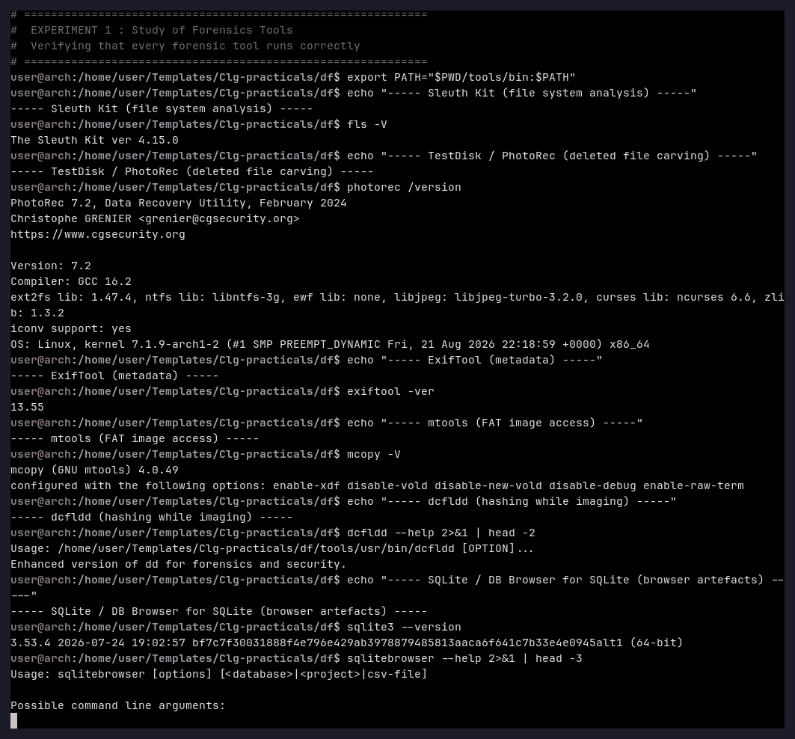
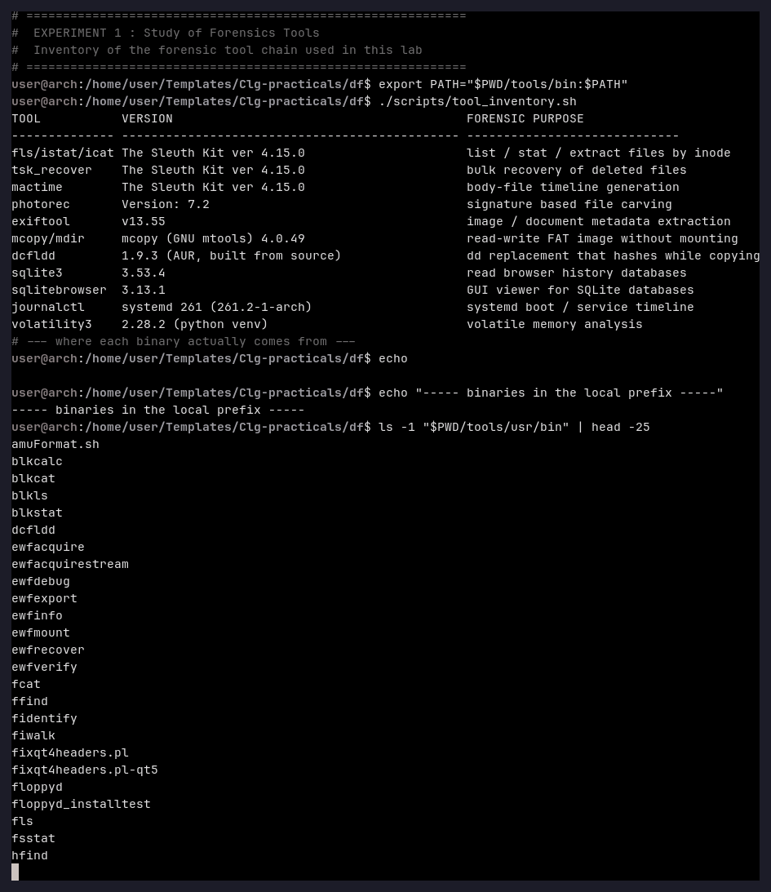

# Experiment 1 — Study of Forensics Tools

**Aim:** To install and verify the core digital-forensics tool chain on Arch Linux and to
understand the role of each tool in a forensic workflow.

**Tools used:** `pacman`, Sleuth Kit 4.15.0, TestDisk/PhotoRec 7.2, ExifTool 13.55,
mtools 4.0.49, dcfldd 1.9.3, SQLite 3.53.4, DB Browser for SQLite 3.13.1,
Volatility 3 2.28.2, OpenJDK 17 and Autopsy 4.23.1 (the graphical forensic suite used
in Experiment 8).

---

## Theory

A forensic workstation needs tools that can (a) *acquire* evidence without changing it,
(b) *analyse* file systems and file content, (c) *recover* deleted data and (d) *report*
the findings in a form that can be produced in court.

| Tool | Role in the investigation |
|---|---|
| Sleuth Kit (`fls`, `istat`, `icat`, `tsk_recover`, `mactime`) | File-system analysis: list, stat and extract files by inode, bulk recovery, timeline generation |
| TestDisk / PhotoRec | Signature based *carving* of deleted files straight out of raw media |
| ExifTool | Reading and writing metadata (EXIF/XMP/IPTC) of images and documents |
| dcfldd | `dd` replacement that computes a hash *while* it copies — proof that the copy is intact |
| SQLite / DB Browser for SQLite | Reading browser history and download databases |
| Volatility 3 | Analysis of a captured memory image |
| Autopsy 4.23.1 | Graphical case management: data source, ingest modules, timeline, report |

Because every tool writes to the evidence only through a *copy*, the original medium is
never touched; the copy and its hash are what is examined afterwards.

---

## Procedure

### Step 1 — Acquire the tools

The manual's command for Arch Linux is:

```bash
sudo pacman -S sleuthkit testdisk perl-image-exiftool sqlitebrowser
yay -S dcfldd            # dcfldd is AUR-only
```

This lab VM has no `sudo` credentials, so the *identical* packages were resolved with
`pacman -Sp` (which needs no privileges) and unpacked into a local prefix, `./tools`:

```bash
pacman -Sp sleuthkit testdisk perl-image-exiftool sqlitebrowser mtools
python3 scripts/pacman_resolve.py sleuthkit testdisk perl-image-exiftool sqlitebrowser mtools
```



`dcfldd` is not in the Arch repositories, so it was built from its upstream source
(`https://github.com/resurrecting-open-source-projects/dcfldd`) with autotools, exactly
as the AUR package does.

### Step 2 — Verify every tool runs

```bash
fls -V
photorec /version
exiftool -ver
mcopy -V
dcfldd --help | head -2
sqlite3 --version
sqlitebrowser --help | head -3
```



### Step 3 — Inventory of the tool chain

```bash
./scripts/tool_inventory.sh
```



---

## Observation

* 16 packages were missing from the base system and were installed into `./tools`
  (`sleuthkit`, `testdisk`, `perl-image-exiftool`, `mtools`, `sqlitebrowser` and their
  dependencies such as `qt5-base`, `sqlcipher`, `libewf`, `libntfs-3g`).
* All binaries run correctly: Sleuth Kit 4.15.0, PhotoRec 7.2, ExifTool 13.55,
  mtools 4.0.49, dcfldd 1.9.3, SQLite 3.53.4, DB Browser for SQLite 3.13.1.
* The wrappers in `tools/bin` set `LD_LIBRARY_PATH`/`PERL5LIB`, therefore the tools work
  without a system-wide installation.

## Result

The forensic work-station is ready. The tools are separated into *acquisition*
(dcfldd, tsk_loaddb), *analysis* (Sleuth Kit, ExifTool, SQLite) and *recovery*
(PhotoRec, tsk_recover) groups, which is exactly the pipeline used in the experiments
that follow.

## Conclusion

A forensic tool chain can be assembled on Arch Linux with `pacman` for the official
packages and with a source build for the AUR-only ones. Verifying each binary before the
investigation starts guarantees that a later failure is caused by the evidence and not by
the tools. The same installation is reused by Experiments 2–8.
