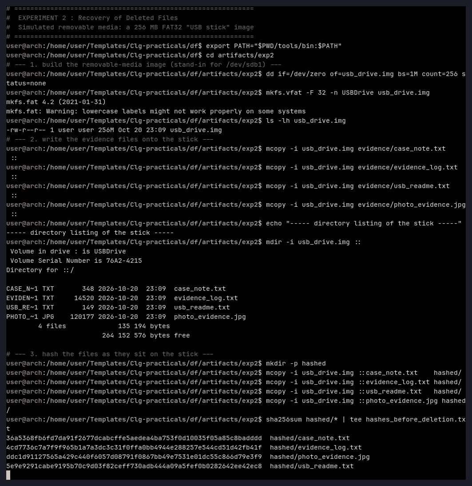
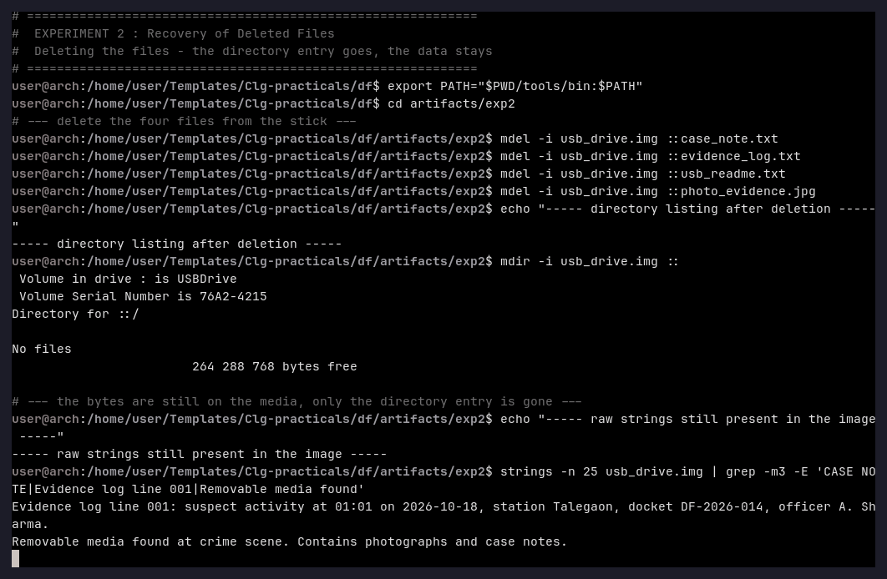
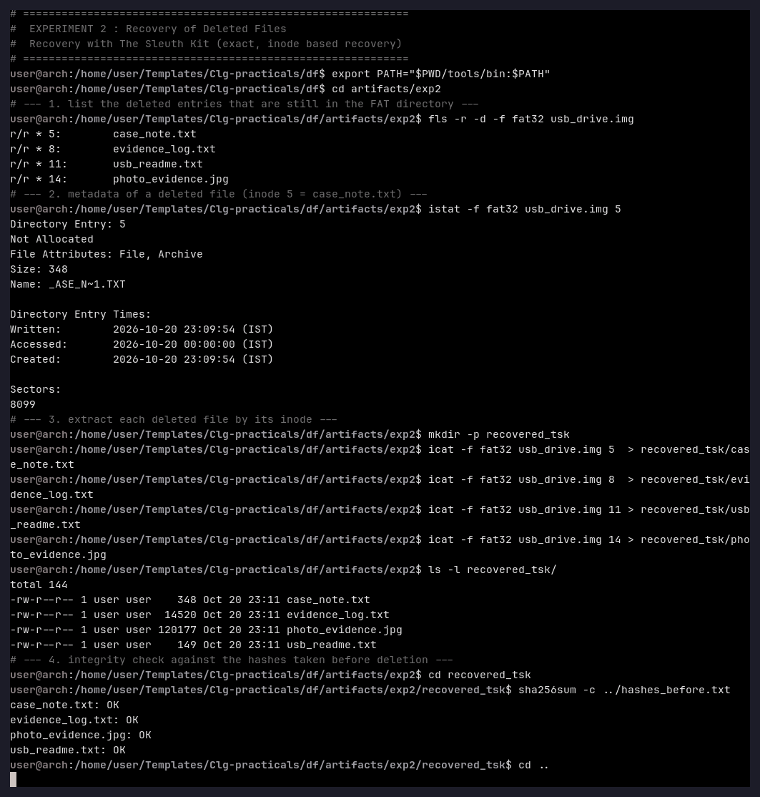
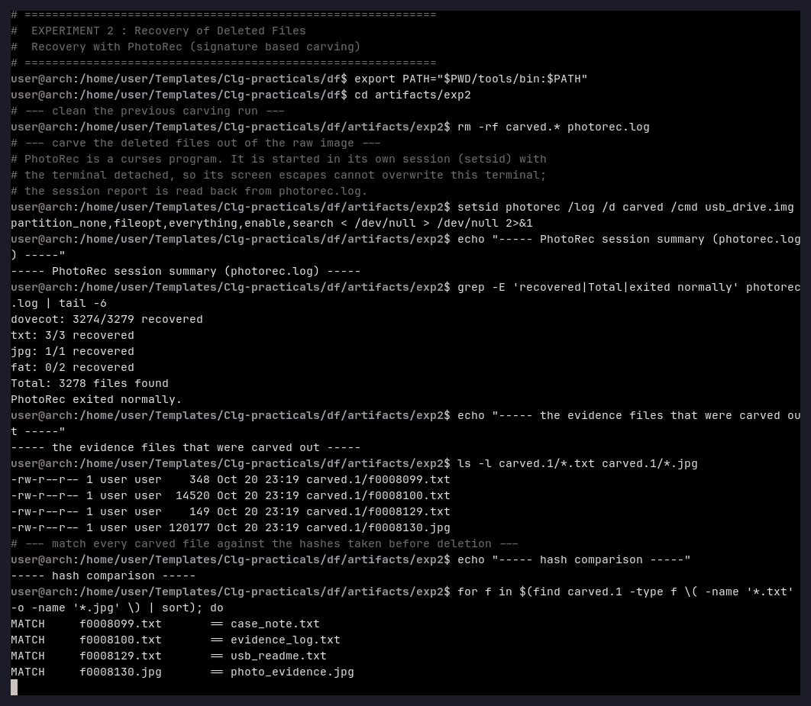

# Experiment 2 — Recovery of Deleted Files

**Aim:** To delete files from a removable FAT32 medium, prove that the data is still
physically present, and recover the files with two independent methods (Sleuth Kit and
PhotoRec), verifying the recovery with SHA-256 hashes.

**Tools used:** `mtools` 4.0.49, `mkfs.vfat` 4.2, Sleuth Kit 4.15.0
(`fls`, `istat`, `icat`), PhotoRec 7.2, `sha256sum`.

---

## Theory

Deleting a file does not erase it. On FAT32 the operation only clears a bit in the
*directory entry* and frees the clusters in the *FAT*. The data clusters keep their old
content until they are reused, which is why deleted files can be recovered.

Two different recovery techniques were compared:

1. **File-system based (Sleuth Kit).** `fls -d` walks the directory structure and reports
   the deleted entries together with their inode numbers. `istat` gives the metadata of a
   deleted file (name, size, timestamps, allocation state) and `icat` extracts its content
   *by inode*. The recovery is exact — the recovered file is byte-identical to the
   original.
2. **Signature based (PhotoRec).** PhotoRec ignores the file system and scans the raw
   medium for known file signatures (JPEG, PDF, text …). It therefore also recovers data
   whose directory entry has been overwritten, but the original file name is lost — the
   files are written out as `fNNNNNNN.<ext>`.

---

## Procedure

The lab VM has no physical USB stick, so the removable medium was *simulated* with a
256 MB FAT32 image file (`usb_drive.img`). Everything else — formatting, writing,
deleting and recovering — is identical to working on a real `/dev/sdb1`.

### Step 1 — Create the medium and write the evidence files onto it

```bash
dd if=/dev/zero of=usb_drive.img bs=1M count=256 status=none
mkfs.vfat -F 32 -n USBDrive usb_drive.img

mcopy -i usb_drive.img evidence/case_note.txt      ::
mcopy -i usb_drive.img evidence/evidence_log.txt   ::
mcopy -i usb_drive.img evidence/usb_readme.txt     ::
mcopy -i usb_drive.img evidence/photo_evidence.jpg ::

mdir -i usb_drive.img ::
sha256sum hashed/*
```



The SHA-256 values recorded **before** the deletion are:

```
36a5368fb6fd7da91f2677dcabcffe5aedea4ba753f0d10035f05a85c8badddd  case_note.txt
4cd7736c7a7f9f965b1a7a3dc3c31f0ffa0bb4944e288257e544cd51d42fb41f  evidence_log.txt
5e9e9291cabe9195b70c9d03f82ceff730adb444a09a5fef0b0282642ee42ec8  usb_readme.txt
ddc1d91127565a429c440f6057d08791f0867bb49e7531e01dc55c866d79e3f9  photo_evidence.jpg
```

### Step 2 — Delete the files

```bash
mdel -i usb_drive.img ::case_note.txt
mdel -i usb_drive.img ::evidence_log.txt
mdel -i usb_drive.img ::usb_readme.txt
mdel -i usb_drive.img ::photo_evidence.jpg
mdir -i usb_drive.img ::

strings -n 25 usb_drive.img | grep -m3 -E 'CASE NOTE|Evidence log line 001|Removable media found'
```



The directory is empty (`No files`), yet the raw strings of the deleted documents are
still present inside the image — the classic starting point of a recovery.

### Step 3 — Recovery with the Sleuth Kit (exact recovery by inode)

```bash
fls -r -d -f fat32 usb_drive.img
istat -f fat32 usb_drive.img 5

mkdir -p recovered_tsk
icat -f fat32 usb_drive.img 5  > recovered_tsk/case_note.txt
icat -f fat32 usb_drive.img 8  > recovered_tsk/evidence_log.txt
icat -f fat32 usb_drive.img 11 > recovered_tsk/usb_readme.txt
icat -f fat32 usb_drive.img 14 > recovered_tsk/photo_evidence.jpg

cd recovered_tsk && sha256sum -c ../hashes_before.txt
```



### Step 4 — Recovery with PhotoRec (signature based carving)

```bash
setsid photorec /log /d carved /cmd usb_drive.img \
        partition_none,fileopt,everything,enable,search >/dev/null 2>&1

grep -E 'recovered|Total|exited normally' photorec.log
ls -l carved.1/*.txt carved.1/*.jpg
```

and every carved file is compared with the pre-deletion hashes:

```bash
for f in $(find carved.1 -type f \( -name '*.txt' -o -name '*.jpg' \)); do
    h=$(sha256sum "$f" | cut -d' ' -f1)
    grep -q "$h" hashes_before.txt && echo "MATCH $f" || echo "NO MATCH $f"
done
```



---

## Observation

| Item | Result |
|---|---|
| Files deleted | 4 (`case_note.txt`, `evidence_log.txt`, `usb_readme.txt`, `photo_evidence.jpg`) |
| Directory after deletion | empty — `mdir` reports *No files* |
| Raw strings still in the medium | present (case note, log lines, read-me) |
| `fls -r -d` | lists all four deleted entries, inodes 5, 8, 11 and 14 |
| `istat` (inode 5) | *Not Allocated*, size 348, name `_ASE_N~1.TXT`, written 2026-10-20 23:09:54 |
| `icat` recovery | 4/4 files recovered, `sha256sum -c` reports **OK** for every file |
| PhotoRec log | `txt: 3/3 recovered`, `jpg: 1/1 recovered`, `Total: 3278 files found` |
| PhotoRec recovery | `f0008099.txt`, `f0008100.txt`, `f0008129.txt`, `f0008130.jpg` — hashes **MATCH** the originals |

## Result

All four deleted files were recovered completely and their integrity was proved with
SHA-256. The Sleuth Kit recovered them with their **original names and exact byte
content**; PhotoRec recovered the same content but renamed the files
(`f0008099.txt`, `f0008130.jpg`, …), because carving has no access to the directory
entries. 3 278 objects were carved in total — the vast majority (3 274 `dovecot`
fragments) are false positives produced by the file system structures themselves, which
shows why a hash comparison is mandatory after a carving run.

## Conclusion

Deleting a file on FAT32 does not destroy the data: the directory entry is removed but
the clusters keep their content. A file-system-aware tool (Sleuth Kit) recovers deleted
files exactly and with their metadata, while a carving tool (PhotoRec) recovers them
from raw signatures even when the directory entry is gone. In a real investigation both
techniques are combined and every recovered file is verified against a hash that was
recorded before the deletion.
