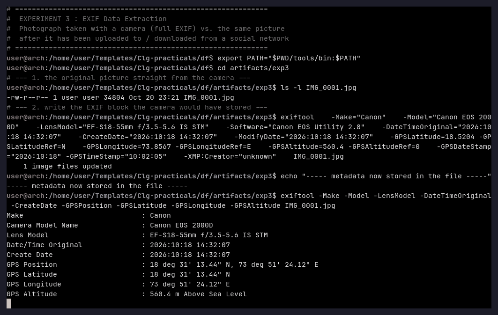
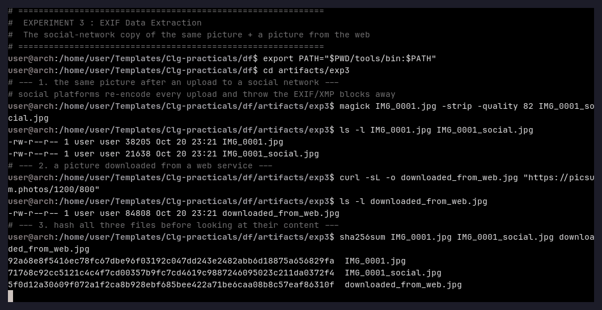
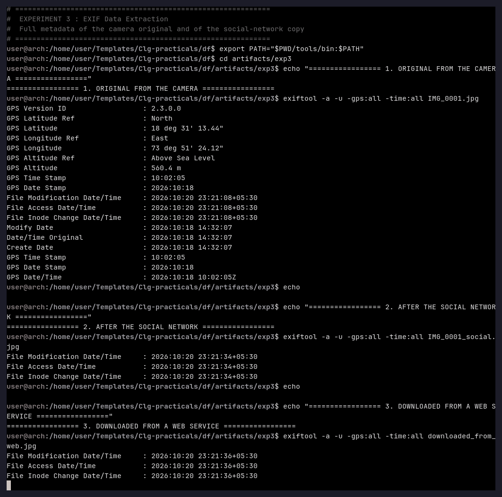

# Experiment 3 — EXIF Data Extraction

**Aim:** To extract the metadata (EXIF) stored inside photographs, and to compare the
metadata of a picture that came straight from a camera with the same picture after it
has been uploaded to / downloaded from a social network.

**Tools used:** ExifTool 13.55, ImageMagick 7 (`magick`), `sha256sum`, `curl`.

---

## Theory

Every JPEG produced by a camera carries an *EXIF* (Exchangeable Image File Format) block
in the APP1 segment. It records the camera make and model, the lens, the capture time and
often the **GPS position** of the camera. XMP and IPTC blocks may add the author and the
software that produced the file.

Social networks (Facebook, Twitter/X, Instagram, WhatsApp …) re-encode every uploaded
image in order to shrink it, and in doing so they **throw the EXIF/XMP blocks away** — a
counter-forensics measure that removes the location and time information. A forensic
investigator therefore has to compare the metadata of the *original* file with the
metadata of the copy that was found on the internet or on a seized device: a copy that
still carries GPS data was never processed by a social network.

---

## Procedure

### Step 1 — The "camera" original

`IMG_0001.jpg` is the picture; the EXIF block a camera would have written is added with
ExifTool:

```bash
exiftool \
  -Make="Canon" \
  -Model="Canon EOS 2000D" \
  -LensModel="EF-S18-55mm f/3.5-5.6 IS STM" \
  -Software="Canon EOS Utility 2.8" \
  -DateTimeOriginal="2026:10:18 14:32:07" \
  -CreateDate="2026:10:18 14:32:07" \
  -ModifyDate="2026:10:18 14:32:07" \
  -GPSLatitude=18.5204 -GPSLatitudeRef=N \
  -GPSLongitude=73.8567 -GPSLongitudeRef=E \
  -GPSAltitude=560.4 -GPSAltitudeRef=0 \
  -GPSDateStamp="2026:10:18" -GPSTimeStamp="10:02:05" \
  -XMP:Creator="unknown" \
  IMG_0001.jpg

exiftool -Make -Model -LensModel -DateTimeOriginal -GPSPosition -GPSLatitude -GPSLongitude -GPSAltitude IMG_0001.jpg
```



### Step 2 — The social-network copy and a picture from the web

```bash
magick IMG_0001.jpg -strip -quality 82 IMG_0001_social.jpg
curl -sL -o downloaded_from_web.jpg "https://picsum.photos/1200/800"
sha256sum IMG_0001.jpg IMG_0001_social.jpg downloaded_from_web.jpg
```



### Step 3 — Compare the metadata of the three files

```bash
exiftool -a -u -gps:all -time:all IMG_0001.jpg
exiftool -a -u -gps:all -time:all IMG_0001_social.jpg
exiftool -a -u -gps:all -time:all downloaded_from_web.jpg
```



---

## Observation

| Tag | Original (`IMG_0001.jpg`) | Social copy | Web download |
|---|---|---|---|
| Make | Canon | *absent* | *absent* |
| Camera Model Name | Canon EOS 2000D | *absent* | *absent* |
| Lens Model | EF-S18-55mm f/3.5-5.6 IS STM | *absent* | *absent* |
| Date/Time Original | 2026:10:18 14:32:07 | *absent* | *absent* |
| GPS Position | **18°31'13.44" N, 73°51'24.12" E** | *absent* | *absent* |
| GPS Altitude | 560.4 m above sea level | *absent* | *absent* |
| GPS Date/Time Stamp | 2026:10:18 10:02:05 | *absent* | *absent* |
| Modify Date | 2026:10:18 14:32:07 | *absent* | *absent* |
| Only present | — | file system timestamps | file system timestamps |

The three files are also different documents, which is visible in their hashes:

```
92a68e8f5416ec78fc67dbe96f03192c047dd243e2482abb6d18875a656829fa  IMG_0001.jpg
71768c92cc5121c4c4f7cd00357b9fc7cd4619c9887246095023c211da0372f4  IMG_0001_social.jpg
5f0d12a30609f072a1f2ca8b928ebf685bee422a71be6caa08b8c57eaf86310f  downloaded_from_web.jpg
```

## Result

ExifTool extracted the complete camera metadata from the original picture — device
(Canon EOS 2000D), optics (EF-S18-55 mm), capture time (2026-10-18 14:32:07) and the
**geographic position of the camera (18°31'13.44" N, 73°51'24.12" E, 560.4 m)**. The
social-network copy of the same picture and the picture downloaded from a web service
contain **no EXIF data at all** — only the file-system timestamps of the copy remain.

## Conclusion

Image metadata survives the re-encode of a camera original only as long as the file is
not processed by a platform that strips it. The presence of a complete EXIF block
(camera, lens, timestamp **and GPS**) proves that a picture was never uploaded to a
social network, while its absence indicates that the file is a processed copy. ExifTool
is therefore one of the most valuable tools of an image-forensics examination, because
the coordinates it returns can place a suspect at a place and a time.
