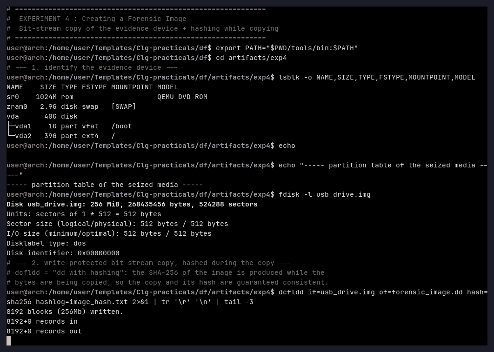
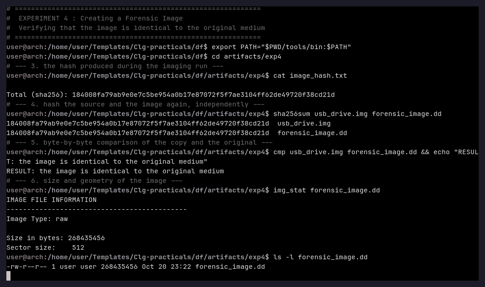
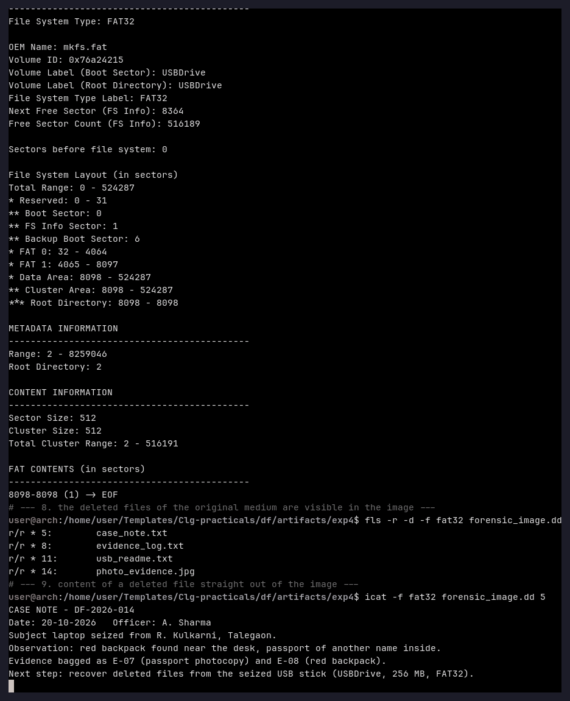

# Experiment 4 — Creating a Forensic Image

**Aim:** To create a bit-stream (forensic) image of the evidence medium, to hash the copy
*while* it is written, and to prove that the copy is identical to the original and can be
examined in place of the medium.

**Tools used:** `lsblk`, `fdisk`, **dcfldd 1.9.3**, `sha256sum`, `cmp`,
Sleuth Kit (`img_stat`, `fsstat`, `fls`, `icat`).

---

## Theory

A forensic image is a *bit-stream copy* of a storage device: every sector, including the
empty ones and the slack space, is copied in the original order. Two rules make such a
copy usable as evidence:

1. **The acquisition must not alter the source.** The original medium is never written to;
   only the copy is examined.
2. **The copy must be provably identical to the source.** This is achieved by computing a
   cryptographic hash (SHA-256) over the copy and recording it in the case notes. If the
   hash of the copy and the hash of the original are identical, the copy is authentic.

`dcfldd` ("DCFL Computer Forensics Lab dd") is an enhanced `dd` that calculates the hash
*while* the data is being copied, so the hash and the image can never belong to different
acquisitions.

---

## Procedure

### Step 1 — Identify the evidence device

```bash
lsblk -o NAME,SIZE,TYPE,FSTYPE,MOUNTPOINT,MODEL
fdisk -l usb_drive.img
```



(The lab VM has no physical USB stick, so the seized medium is the FAT32 image
`usb_drive.img` of Experiment 2 — 256 MiB, DOS disklabel.)

### Step 2 — Create the image and hash it during the copy

```bash
dcfldd if=usb_drive.img of=forensic_image.dd hash=sha256 hashlog=image_hash.txt
```

### Step 3 — Verify the image

```bash
cat image_hash.txt
sha256sum usb_drive.img forensic_image.dd
cmp usb_drive.img forensic_image.dd && echo "RESULT: the image is identical to the original medium"
img_stat forensic_image.dd
```



### Step 4 — Examine the image instead of the medium

```bash
fsstat forensic_image.dd
fls -r -d -f fat32 forensic_image.dd
icat -f fat32 forensic_image.dd 5
```



---

## Observation

```
Total (sha256): 184008fa79ab9e0e7c5be954a0b17e87072f5f7ae3104ff62de49720f38cd21d
```

* The hash produced **during** the imaging run is identical to the hash of the source
  medium and to the hash of the finished image:
  `184008fa79ab9e0e7c5be954a0b17e87072f5f7ae3104ff62de49720f38cd21d`.
* `cmp` reports no difference — the copy is byte-identical to the original.
* `img_stat`: image type *raw*, size 268 435 456 bytes, sector size 512.
* `fsstat` on the image: FAT32, volume label `USBDrive`, volume ID `0x76a24215`.
* `fls -r -d` on the image still lists the four deleted files (inodes 5, 8, 11, 14) and
  `icat` returns the content of the deleted note — the image carries the *whole* medium,
  not only the allocated files.

## Result

A 256 MiB raw forensic image was produced from the evidence medium, hashed **while**
being written. The SHA-256 recorded in `image_hash.txt`, the hash of the source and the
hash of the image are all identical, and a byte-by-byte comparison (`cmp`) confirms the
copy. The image can be used for all further analysis (`fsstat`, `fls`, `icat`) exactly as
if the physical device were attached.

## Conclusion

A forensic image is only evidence if it can be proved authentic. Hashing during the
acquisition with `dcfldd` and verifying the copy with `sha256sum` and `cmp` establishes
that the image is a faithful copy of the medium. Working on the image instead of the
original also guarantees that the acquisition itself can be repeated and audited at any
time, which is what a court expects.
