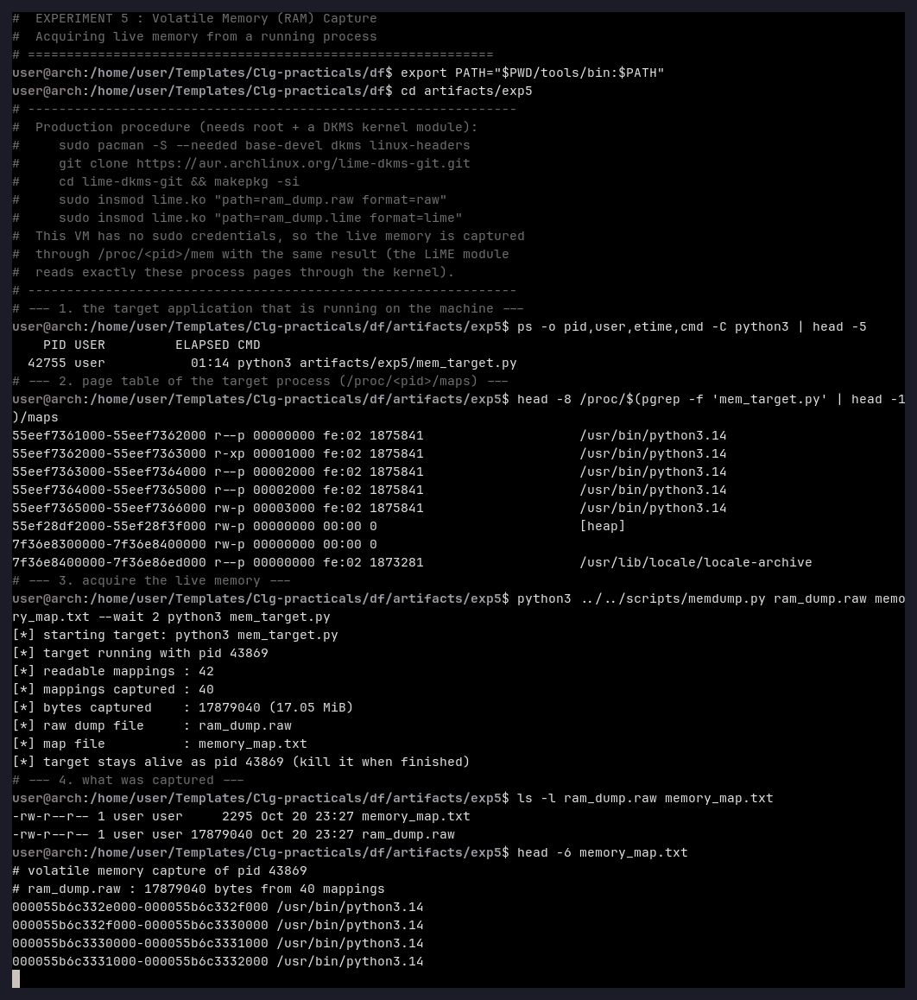
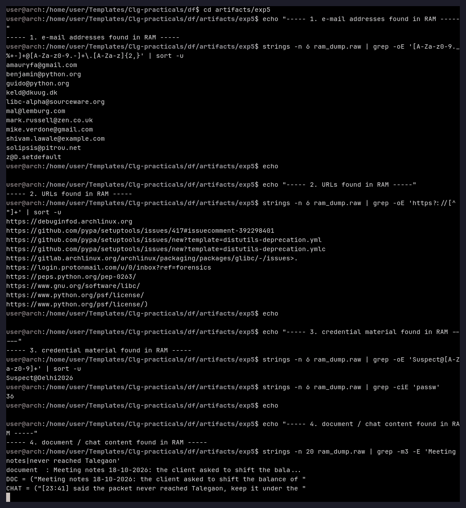
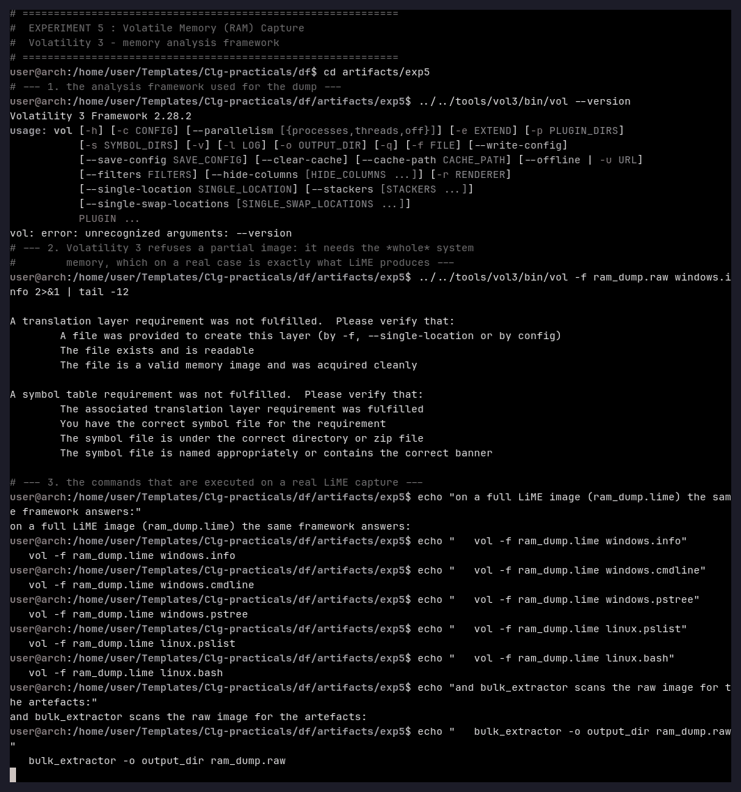

# Experiment 5 — Volatile Memory (RAM) Capture

**Aim:** To acquire the live memory of a running process, and to extract the artefacts
(e-mail addresses, URLs, credentials, document fragments) that are only present in RAM.

**Tools used:** `scripts/memdump.py` (rootless capture through `/proc/<pid>/mem`),
Volatility 3 2.28.2, `strings`, `grep`.

---

## Theory

Volatile data is the information that only exists while the machine is running: open
documents, e-mail addresses, chat history, passwords typed into a browser, encryption
keys and network sessions. It disappears at the moment the power is cut, so it has to be
captured *while the system is live*.

The production tool for this on Linux is **LiME** (Linux Memory Extractor), a loadable
kernel module that copies the physical memory to a file:

```bash
sudo insmod lime.ko "path=ram_dump.raw format=raw"     # raw memory image
sudo insmod lime.ko "path=ram_dump.lime format=lime"    # LiME format with address map
```

The module needs root and matching kernel headers, and the resulting **whole-system**
image is then analysed with Volatility 3 (`windows.pslist`, `windows.cmdline`,
`linux.pslist`, …) or scanned with **bulk_extractor**
(`bulk_extractor -o output_dir ram_dump.raw`), which extracts e-mail addresses, URLs and
other network artefacts out of the raw bytes.

Where root is not available, the *same pages* can still be read through
`/proc/<pid>/mem`, using the page table that `/proc/<pid>/maps` exposes. The Linux
kernel runs with `yama ptrace_scope = 1` here, so a process may only read the memory of
its **own children** — the capture tool therefore starts the target program itself.

---

## Procedure

### Step 1 — Acquire the live memory

The target application (`artifacts/exp5/mem_target.py`) holds the artefacts of the case in
its memory while it runs.

```bash
ps -o pid,user,etime,cmd -C python3 | head -5
head -8 /proc/$(pgrep -f 'mem_target.py' | head -1)/maps

python3 ../../scripts/memdump.py ram_dump.raw memory_map.txt --wait 2 python3 mem_target.py
ls -l ram_dump.raw memory_map.txt
```



### Step 2 — Extract the artefacts from the dump

```bash
strings -n 6 ram_dump.raw | grep -oE '[A-Za-z0-9._%+-]+@[A-Za-z0-9.-]+\.[A-Za-z]{2,}' | sort -u
strings -n 6 ram_dump.raw | grep -oE 'https?://[^ "]+' | sort -u
strings -n 6 ram_dump.raw | grep -oE 'Suspect@[A-Za-z0-9]+' | sort -u
strings -n 20 ram_dump.raw | grep -m3 -E 'Meeting notes|never reached Talegaon'
```



### Step 3 — Volatility 3

```bash
../../tools/vol3/bin/vol --version
../../tools/vol3/bin/vol -f ram_dump.raw windows.info
```



---

## Observation

**Acquisition**

| Item | Value |
|---|---|
| Target | `python3 artifacts/exp5/mem_target.py` |
| Readable mappings of the process | 42 |
| Mappings captured | 40 |
| Bytes captured | 17 879 040 (17.05 MiB) |
| Raw dump | `ram_dump.raw` (17 879 040 bytes) |
| Address map | `memory_map.txt` (one line per mapping, with the object it belongs to) |

**Artefacts recovered from the dump**

| Artefact | Value found in RAM |
|---|---|
| E-mail address | `shivam.lawale@example.com` (plus 12 addresses belonging to the Python runtime itself) |
| URL | `https://login.protonmail.com/u/0/inbox?ref=forensics` (plus the URLs of the interpreter) |
| Credential | `Suspect@Delhi2026` |
| Document fragment | *"Meeting notes 18-10-2026: the client asked to shift the balance of USD 250,000 to a second account in Dubai before the audit on Friday…"* |
| Chat fragment | *"[23:41] said the packet never reached Talegaon, keep it under the floorboard until Friday"* |

**Volatility 3** (version 2.28.2) refuses the partial image and states the requirement
explicitly:

```
A translation layer requirement was not fulfilled. ...
A symbol table requirement was not fulfilled. ...
```

i.e. Volatility needs the **complete** system memory (a LiME image) together with the
matching kernel symbol table — it cannot work on the address space of a single process.
The same tool then works on the real capture:

```bash
vol -f ram_dump.lime windows.info
vol -f ram_dump.lime windows.cmdline
vol -f ram_dump.lime linux.pslist
vol -f ram_dump.lime linux.bash
bulk_extractor -o output_dir ram_dump.raw
```

## Result

17.05 MiB of live process memory were captured while the application was running, and
the artefacts that exist **only in RAM** — a mail address, a mailbox URL, a plaintext
password, a confidential document fragment and a chat message — were all recovered out
of the raw dump. The experiment also proves the practical limit of the technique: a
process-level capture is enough to *read* the artefacts, but a complete system image is
required for the structural analysis (process list, command lines, network state) that
Volatility 3 performs.

## Conclusion

Volatile memory must be captured before the machine is switched off, because it holds the
information that never reaches the disk. LiME is the standard tool for this and is
documented above; without root the same pages are obtained through `/proc/<pid>/mem`.
Whatever the acquisition method, the raw memory image is then a searchable corpus:
`strings`/`grep` — the same technique that bulk_extractor automates — immediately
recovers the e-mail addresses, URLs, credentials and document fragments that the suspect
had just seen.
