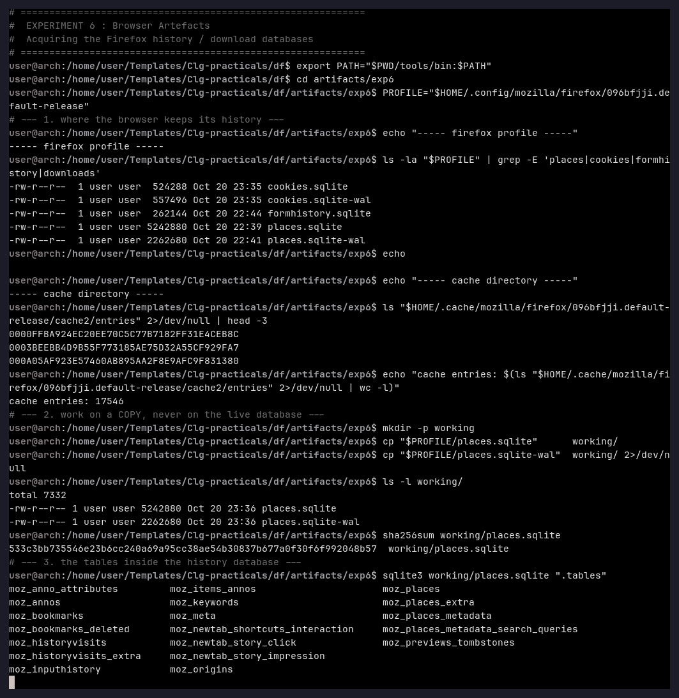
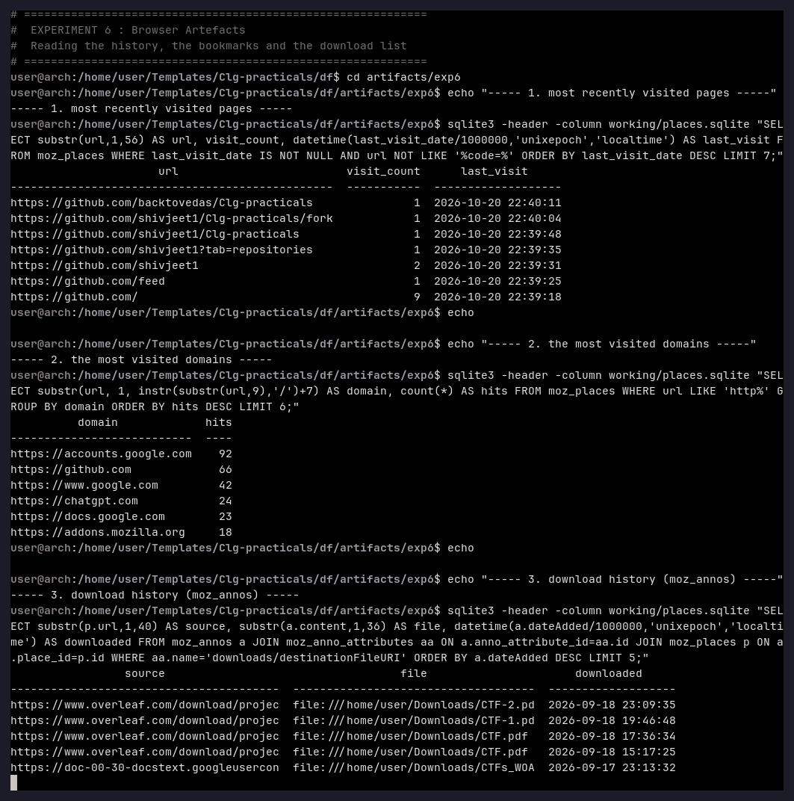
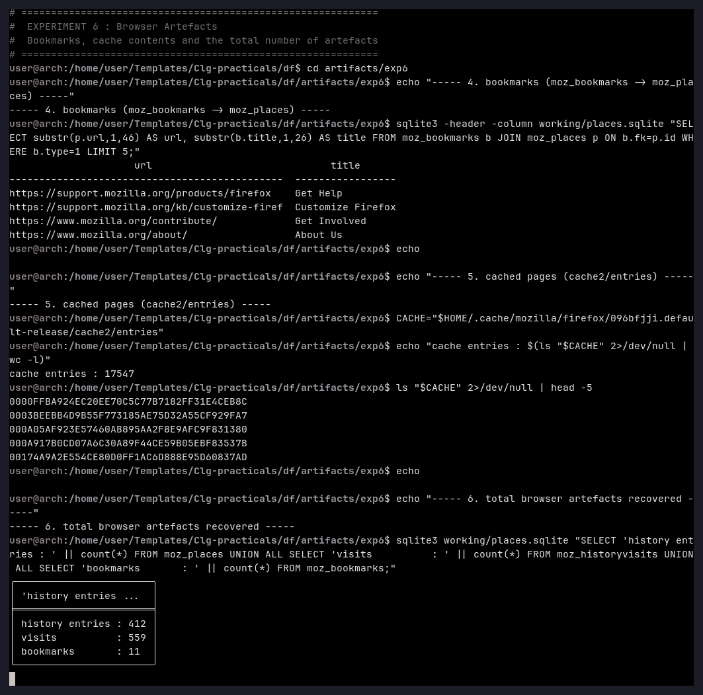
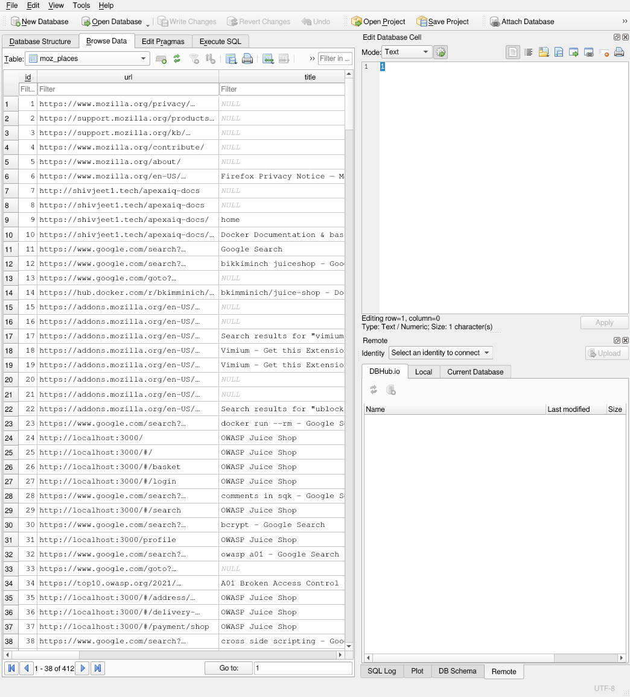

# Experiment 6 — Browser Artefacts

**Aim:** To acquire and analyse the artefacts left by a web browser — browsing history,
visited pages, download list, bookmarks and cache — without modifying the live database.

**Tools used:** SQLite 3.53.4, DB Browser for SQLite 3.13.1, `sha256sum`, Firefox
profile `~/.config/mozilla/firefox/096bfjji.default-release`.

---

## Theory

A browser is one of the richest sources of forensic evidence, because every click is
written into a plain SQLite database inside the profile:

| Firefox artefact | Location | Important tables |
|---|---|---|
| History / visited pages | `places.sqlite` | `moz_places`, `moz_historyvisits`, `moz_origins` |
| Download list | `places.sqlite` | `moz_annos` + `moz_anno_attributes` (`downloads/destinationFileURI`) |
| Bookmarks | `places.sqlite` | `moz_bookmarks` (+ `moz_places` for the URL) |
| Cache | `cache2/entries/` | one file per cached object |
| Cookies / form data | `cookies.sqlite`, `formhistory.sqlite` | — |

Two rules apply: the database must **never be opened in the live profile** (Firefox
writes to it while it runs, and the write-ahead log `places.sqlite-wal` holds the most
recent entries), and every copy must be **hashed** before it is examined.

The Chrome/Chromium equivalent is `~/.config/google-chrome/Default/History`, which is
also a SQLite database (`urls`, `visits`, `downloads`, `downloads_url_chains`).

---

## Procedure

### Step 1 — Locate and copy the profile

```bash
PROFILE="$HOME/.config/mozilla/firefox/096bfjji.default-release"
ls -la "$PROFILE" | grep -E 'places|cookies|formhistory'
ls "$HOME/.cache/mozilla/firefox/096bfjji.default-release/cache2/entries" | head -3

mkdir -p working
cp "$PROFILE/places.sqlite"     working/
cp "$PROFILE/places.sqlite-wal" working/
sha256sum working/places.sqlite
sqlite3 working/places.sqlite ".tables"
```



### Step 2 — Read the history, the domains and the downloads

```sql
-- most recently visited pages
SELECT substr(url,1,56), visit_count,
       datetime(last_visit_date/1000000,'unixepoch','localtime')
FROM moz_places WHERE last_visit_date IS NOT NULL ORDER BY last_visit_date DESC LIMIT 7;

-- most visited domains
SELECT substr(url,1,instr(substr(url,9),'/')+7), count(*)
FROM moz_places WHERE url LIKE 'http%' GROUP BY 1 ORDER BY 2 DESC LIMIT 6;

-- download list
SELECT substr(p.url,1,40), substr(a.content,1,36),
       datetime(a.dateAdded/1000000,'unixepoch','localtime')
FROM moz_annos a
  JOIN moz_anno_attributes aa ON a.anno_attribute_id = aa.id
  JOIN moz_places p ON a.place_id = p.id
WHERE aa.name = 'downloads/destinationFileURI'
ORDER BY a.dateAdded DESC LIMIT 5;
```



### Step 3 — Bookmarks, cache and totals

```sql
SELECT substr(p.url,1,46), substr(b.title,1,26)
FROM moz_bookmarks b JOIN moz_places p ON b.fk = p.id WHERE b.type = 1 LIMIT 5;

SELECT 'history entries : ' || count(*) FROM moz_places
UNION ALL SELECT 'visits : ' || count(*) FROM moz_historyvisits
UNION ALL SELECT 'bookmarks : ' || count(*) FROM moz_bookmarks;
```



### Step 4 — The same database in the GUI (DB Browser for SQLite)

```bash
sqlitebrowser artifacts/exp6/working/places.sqlite
```



---

## Observation

| Artefact | Value |
|---|---|
| Profile | `~/.config/mozilla/firefox/096bfjji.default-release` |
| Database copied | `places.sqlite` (5 242 880 bytes) + `places.sqlite-wal` (2 262 680 bytes) |
| Tables | 21 tables, 25 indices (`moz_places`, `moz_historyvisits`, `moz_annos`, `moz_bookmarks`, `moz_origins`, …) |
| History entries | **412** |
| Visits | **559** |
| Bookmarks | **11** |
| Download annotations | 12 (`downloads/destinationFileURI` + `downloads/metaData`) |
| Cache | **17 548** entries in `cache2/entries` |
| Most visited domains | accounts.google.com (92), github.com (66), google.com (42), chatgpt.com (24) |
| Latest downloads | `file:///home/user/Downloads/CTF-2.pdf` (2026-09-18 23:09:35), `CTF-1.pdf`, `CTF.pdf`, `CTFs_WOA-1.pdf`, `CTFs_WOA.pdf` |

In the GUI, the `moz_places` table is displayed with all **412** rows of history, showing
for every entry the URL, the page title, the visit count and the visit timestamps.

## Result

A complete set of browser artefacts was acquired from the Firefox profile and read out of
the SQLite database without touching the live profile: 412 history entries with their
visit times, 559 individual visits, 11 bookmarks, 6 dated downloads (with the target
file name and the exact download time) and 17 548 cache objects. The same evidence was
additionally reviewed graphically in DB Browser for SQLite, which confirms the result
independently of the command line.

## Conclusion

Browser databases are ordinary SQLite files and can be examined with standard tools
without any special software. Because they record *what was visited, what was searched,
what was downloaded and when*, they are among the strongest artefacts for reconstructing
a user's activity. The correct procedure is: copy the database **and its write-ahead
log**, hash the copy, and analyse only the copy — the live profile must remain
unmodified.
