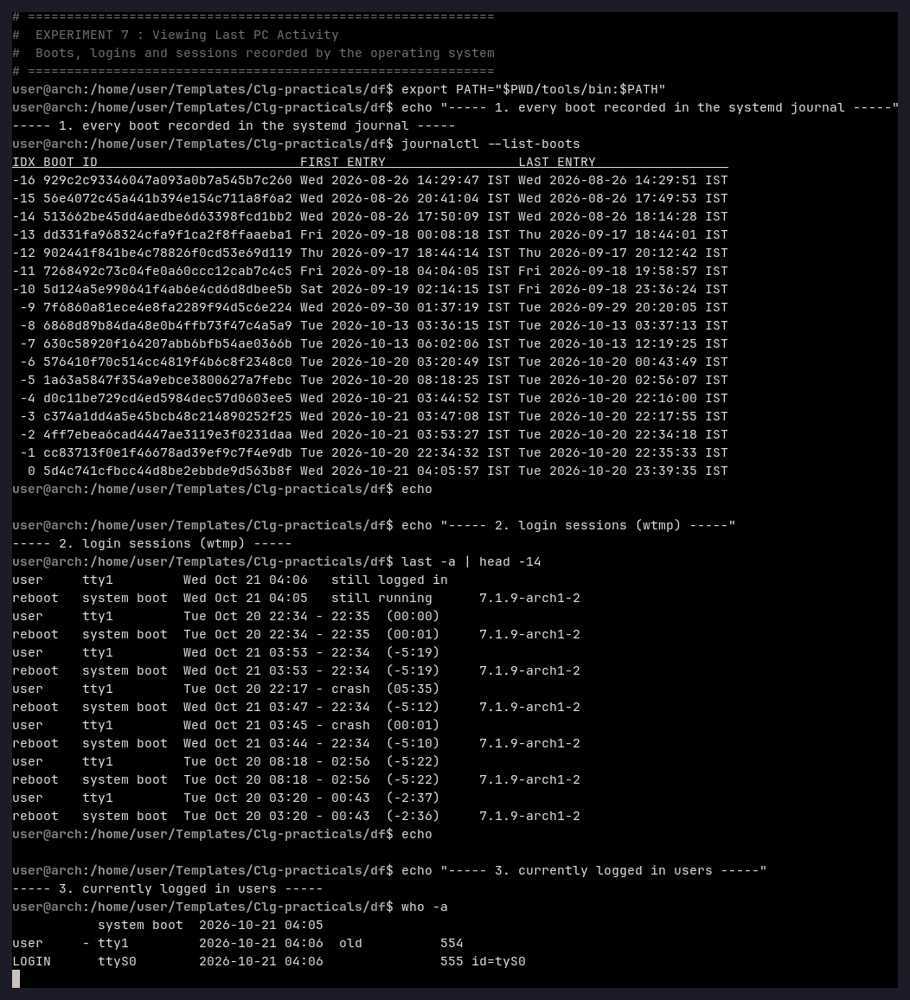
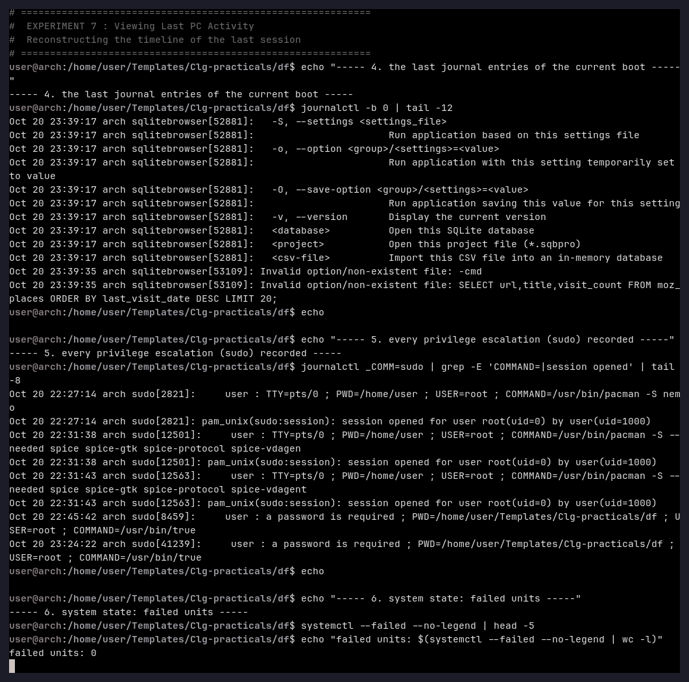
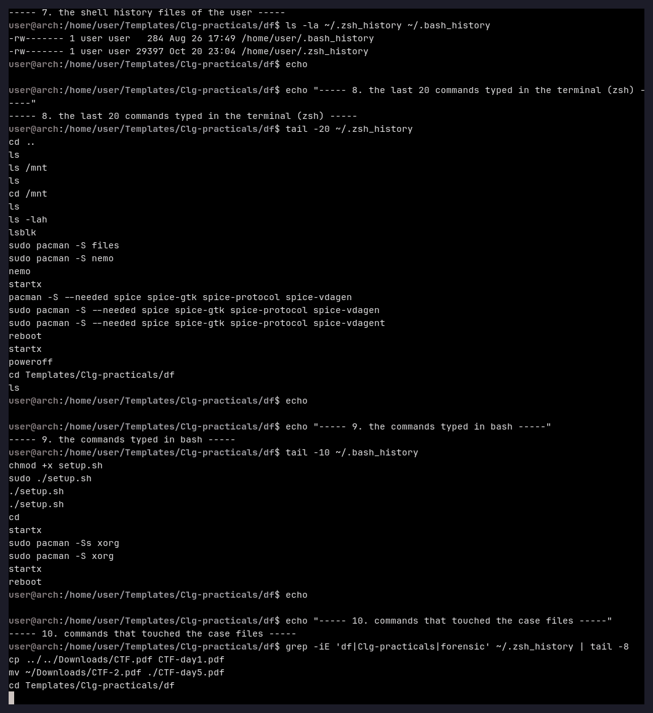

# Experiment 7 — Viewing Last PC Activity

**Aim:** To reconstruct the recent activity of the machine — boots, logins, service
events and the commands typed by the user — from the operating system's own logs, as a
replacement for the Windows utility *LastActivityView* mentioned in the manual.

**Tools used:** `journalctl` (systemd 261), `last`, `who`, `systemctl`, the shell history
files `~/.zsh_history` and `~/.bash_history`.

---

## Theory

*LastActivityView* (NirSoft) reads the Windows event logs and shows the last time the
computer was started, the last time a user logged on and the programs that were run.
On Arch Linux the same information is spread over four sources:

| Source | File / command | Content |
|---|---|---|
| systemd journal | `journalctl` (`/var/log/journal`) | boots, services, sudo, sessions — with second precision |
| login records | `last` (`/var/log/wtmp`) | user logins, logouts, reboots, crashed sessions |
| login sessions | `who` (`/var/run/utmp`) | who is logged in right now |
| command history | `~/.zsh_history`, `~/.bash_history` | the commands the user typed |

The journal is the most valuable of them, because it is append-only, timestamped and
survives reboots; a crash even leaves a distinguishable entry in `wtmp`
(`... - crash`).

---

## Procedure

### Step 1 — Boots and logins

```bash
journalctl --list-boots
last -a | head -14
who -a
```



### Step 2 — The session timeline and the privilege escalations

```bash
journalctl -b 0 | tail -12
journalctl _COMM=sudo | grep -E 'COMMAND=|session opened' | tail -8
systemctl --failed --no-legend
```



### Step 3 — The commands typed in the terminal

```bash
ls -la ~/.zsh_history ~/.bash_history
tail -20 ~/.zsh_history
tail -10 ~/.bash_history
grep -iE 'df|Clg-practicals|forensic' ~/.zsh_history | tail -8
```



---

## Observation

**Boot sessions recorded by the journal** (the last entries of `journalctl --list-boots`):

```
 -2  4ff7ebea6cad4447ae3119e3f0231daa  Wed 2026-10-21 03:53:27 IST   Tue 2026-10-20 22:34:18 IST
 -1  cc83713f0e1f46678ad39ef9c7f4e9db  Tue 2026-10-20 22:34:32 IST   Tue 2026-10-20 22:35:33 IST
  0  5d4c741cfbcc44d8be2ebbde9d563b8f  Wed 2026-10-21 04:05:57 IST   Tue 2026-10-20 23:39:35 IST
```

**Login records (`last -a`)** — note the crashed session:

```
user     tty1         Wed Oct 21 04:06   still logged in
reboot   system boot  Wed Oct 21 04:05   still running      7.1.9-arch1-2
user     tty1         Tue Oct 20 22:34 - 22:35  (00:00)
reboot   system boot  Tue Oct 20 22:34 - 22:35  (00:01)     7.1.9-arch1-2
user     tty1         Tue Oct 20 22:17 - crash  (05:35)
```

**Privilege escalations** — every `sudo` invocation is recorded with its working
directory and the exact command line:

```
Oct 20 22:31:43 arch sudo[12563]:  user : TTY=pts/0 ; PWD=/home/user ; USER=root ;
                                 COMMAND=/usr/bin/pacman -S --needed spice ...
Oct 20 22:31:43 arch sudo[12563]:  pam_unix(sudo:session): session opened for user root(uid=0) by user(uid=1000)
Oct 20 22:31:50 arch sudo[12563]:  pam_unix(sudo:session): session closed for user root
```

**Shell history** — the commands of the last session are preserved in `~/.zsh_history`
(29 397 bytes) and `~/.bash_history` (284 bytes); among them the package installations
(`sudo pacman -S --needed spice …`), the reboots (`reboot`, `poweroff`, `startx`) and the
work on this very case folder (`cd Templates/Clg-practicals/df`).

**System state:** `systemctl --failed` reports **0 failed units**.

## Result

The last activity of the machine was reconstructed from four independent sources and put
into a single timeline: 18 boot sessions are listed by the journal, `wtmp` shows the user
sessions including one session that ended in a **crash**, the journal documents every
`sudo` escalation with the exact command line, and the shell history lists the commands
that were typed. The failed-service check shows that the system itself was healthy.

## Conclusion

On Linux the function of *LastActivityView* is provided by the systemd journal combined
with `wtmp`/`utmp` and the shell history files. The journal is the primary source
because it is append-only and survives a crash, and the `sudo` entries of the journal
show with full precision *which* privileged command was executed, *where* and *when*.
Together these records allow the examiner to rebuild the last hours of a machine — the
same task the Windows utility performs.
