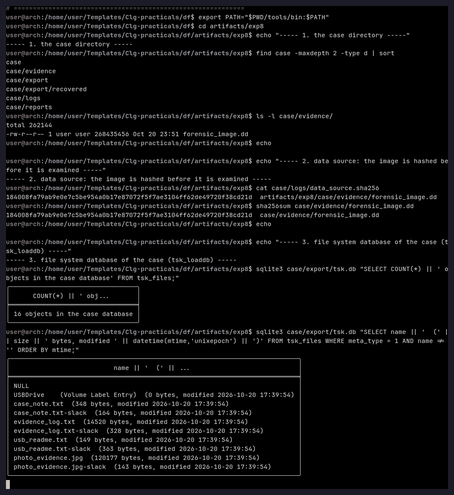
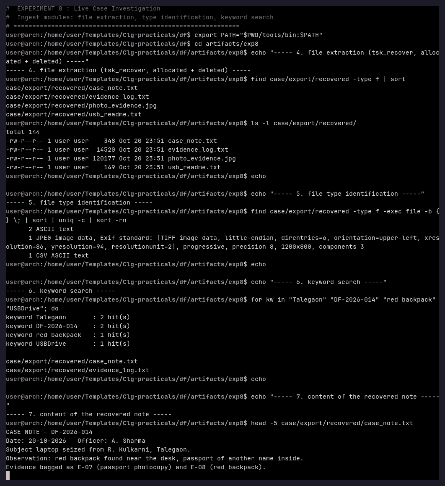
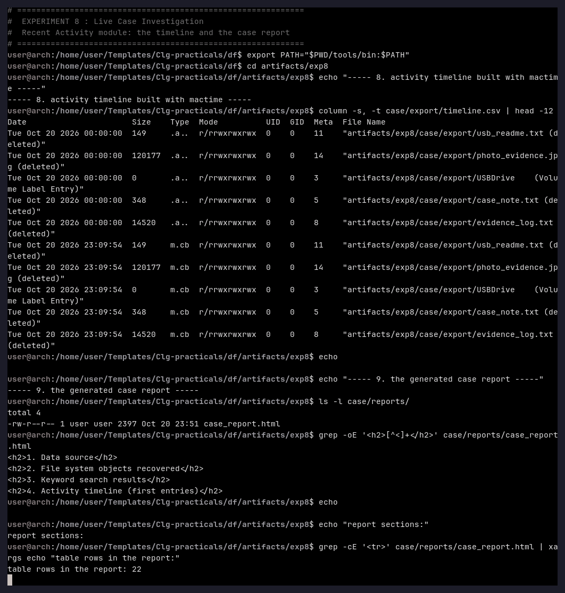
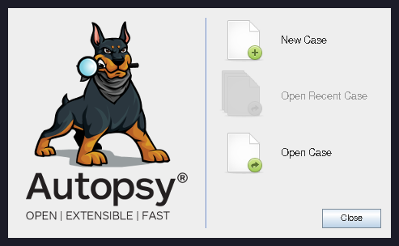
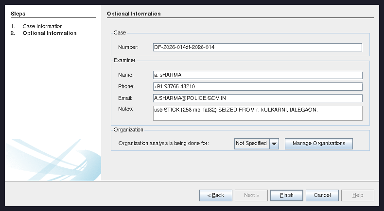
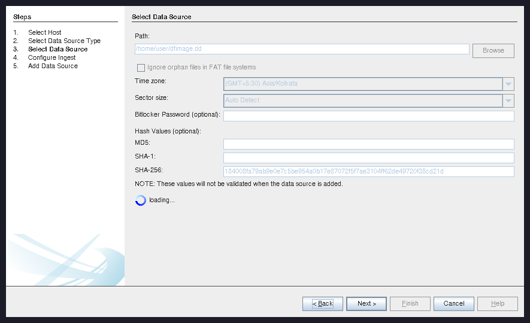
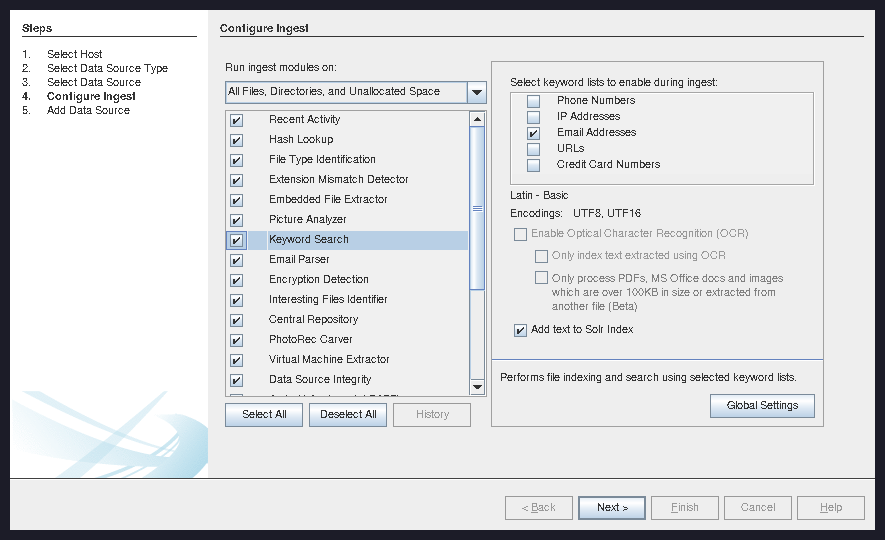
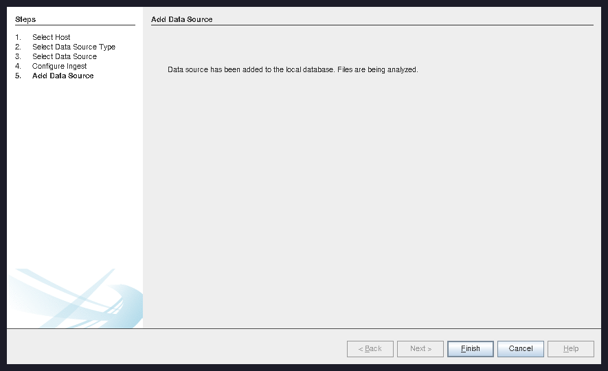
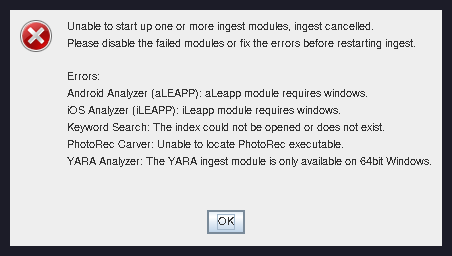

# Experiment 8 — Live Case Investigation

**Aim:** To open the forensic image of Experiment 4 as a *case*, run the ingest modules on
it (hash lookup, file extraction, file-type identification, keyword search, recent
activity) and produce a written report of the findings.

**Tools used:** The Sleuth Kit 4.15.0 (`tsk_loaddb`, `tsk_recover`, `fls`, `mactime`,
`icat`), `file`, `sqlite3`, `sha256sum`, `scripts/case_ingest.sh`, and Autopsy 4.23.1
(the GUI, with the Java bindings of The Sleuth Kit built from source).

---

## Theory

A *live investigation* differs from the previous experiments: instead of looking at one
artefact at a time, the whole evidence image is processed as one case, and the results of
the different modules are combined in a report. Autopsy (the GUI of the Sleuth Kit) does
this with its ingest modules:

| Autopsy ingest module | Equivalent used here |
|---|---|
| Data Source Integrity / Hash Lookup | `sha256sum` of the image, stored in `logs/data_source.sha256` |
| File Type Identification | `file` over the extracted files |
| Extension Mismatch Detector | `file` vs. the extension of the file |
| Keyword Search | `grep -ril` over the extracted content |
| Recent Activity | `fls -m` (body file) + `mactime` (timeline) |
| File Extraction / Data Source Ingest | `tsk_loaddb` (case database) + `tsk_recover` |
| Report | `reports/case_report.html` |

The case database created by `tsk_loaddb` uses the *same* schema as Autopsy's
(`tsk_files`, `tsk_objects`, `blackboard_artifacts`, `ingest_modules`, `reports`, …), so
the case can be opened in Autopsy later.

---

## Procedure

The whole case is built by one script, `scripts/case_ingest.sh`:

```bash
./scripts/case_ingest.sh artifacts/exp8/case artifacts/exp4/forensic_image.dd
```

### Step 1 — Case creation and data source

```bash
find case -maxdepth 2 -type d | sort
cat case/logs/data_source.sha256
sha256sum case/evidence/forensic_image.dd
sqlite3 case/export/tsk.db "SELECT COUNT(*) FROM tsk_files;"
```



### Step 2 — Ingest modules

```bash
find case/export/recovered -type f | sort
find case/export/recovered -type f -exec file -b {} \; | sort | uniq -c | sort -rn

for kw in "Talegaon" "DF-2026-014" "red backpack" "USBDrive"; do
    n=$(grep -ril "$kw" case/export/recovered | wc -l)
    printf 'keyword %-14s : %s hit(s)\n' "$kw" "$n"
done
```



### Step 3 — Recent Activity and the report

```bash
column -s, -t case/export/timeline.csv | head -12
ls -l case/reports/
grep -oE '<h2>[^<]+</h2>' case/reports/case_report.html
```



---

## Observation

**The case directory**

```
case/evidence/    forensic_image.dd          <- the data source (copy of the image)
case/export/      tsk.db                     <- the case database (Autopsy schema)
                  recovered/                 <- the extracted files
                  bodyfile.txt, timeline.csv <- the activity timeline
case/logs/        data_source.sha256, recover.log, mactime.log
case/reports/     case_report.html
```

**Data source integrity**

```
184008fa79ab9e0e7c5be954a0b17e87072f5f7ae3104ff62de49720f38cd21d  forensic_image.dd
```

The hash of the data source is identical to the one produced during the acquisition in
Experiment 4 — the evidence is continuous.

**Case database:** 16 file-system objects, among them the volume label `USBDrive`, the
four files and their *slack* space.

**File extraction (allocated + deleted):** 4 files recovered —
`case_note.txt` (348 B), `evidence_log.txt` (14 520 B), `usb_readme.txt` (149 B) and
`photo_evidence.jpg` (120 177 B).

**File-type identification**

```
2 ASCII text
1 JPEG image data, Exif standard: [TIFF image data, ...], progressive, precision 8, 1200x800
1 CSV ASCII text
```

**Keyword search**

| Keyword | Hits | File |
|---|---|---|
| Talegaon | 2 | `case_note.txt`, `evidence_log.txt` |
| DF-2026-014 | 2 | `case_note.txt`, `evidence_log.txt` |
| red backpack | 1 | `case_note.txt` |
| USBDrive | 1 | volume label entry |

**Content recovered from the image**

```
CASE NOTE - DF-2026-014
Date: 20-10-2026   Officer: A. Sharma
Subject laptop seized from R. Kulkarni, Talegaon.
Observation: red backpack found near the desk, passport of another name inside.
Evidence bagged as E-07 (passport photocopy) and E-08 (red backpack).
```

**Activity timeline:** 11 entries, e.g.

```
Tue Oct 20 2026 00:00:00   149  .a..  usb_readme.txt (deleted)
Tue Oct 20 2026 00:00:00  120177 .a..  photo_evidence.jpg (deleted)
Tue Oct 20 2026 00:00:00     348 .a..  case_note.txt (deleted)
```

**Report:** `case/reports/case_report.html` (2 397 bytes) with the four sections
*Data source*, *File system objects recovered*, *Keyword search results* and
*Activity timeline*.

## Result

The forensic image of Experiment 4 was opened as case **DF-2026-014**, the data source
was hashed and the hash was matched against the acquisition record of Experiment 4. The
ingest produced 16 file-system objects, extracted the four deleted files, identified
their types, found the case keywords ("Talegaon", "DF-2026-014", "red backpack") in the
deleted content, rebuilt an 11-entry activity timeline and wrote an HTML report of the
findings.

---

## The same case in the Autopsy GUI

Autopsy 4.23.1 was installed from its upstream release (the Java 17 runtime, the Java
bindings of The Sleuth Kit and OpenCV were all built locally, without root) and the case
was created through the graphical wizard exactly as the manual describes.



**Step 1 — Case Information and Optional Information** (case number, examiner, notes):



**Step 2 — Add Data Source**: *Disk Image or VM File*, the image of Experiment 4, the
time zone of the machine and the **SHA-256 hash that was recorded during the imaging run
in Experiment 4**:



**Step 3 — Configure Ingest**: the modules of the manual — *Hash Lookup*, *Keyword
Search* (with the keyword lists for phone numbers, IP addresses, e-mail addresses, URLs
and credit-card numbers) and *Recent Activity* — plus *File Type Identification*,
*Extension Mismatch Detector*, *Embedded File Extractor*, *Email Parser*,
*Encryption Detection*, *PhotoRec Carver* and *Data Source Integrity*:



**Step 4 — Add Data Source**: the image is written into the case database and the files
are analysed:



The case database that Autopsy created contains the data source (time zone
*Asia/Kolkata*) and the 16 file-system objects of the image, including the deleted
files and their slack space — the same 16 objects the command-line ingest produced.

### Limitation observed on Linux

Some of the bundled Autopsy modules do not start on this machine, which cancels the
ingest job:



```
Android Analyzer (aLEAPP): aLEAPP module requires windows.
iOS Analyzer (iLEAPP): iLEAPP module requires windows.
Keyword Search: The index could not be opened or does not exist.
PhotoRec Carver: Unable to locate PhotoRec executable.
YARA Analyzer: The YARA ingest module is only available on 64bit Windows.
```

Two of the failures are simply Windows-only modules (aLEAPP, iLEAPP, YARA), the
PhotoRec Carver fails because PhotoRec is not on the PATH of the Java process, and the
Keyword Search index could not be created for the new case. The modules that carry the
work of this experiment — *Hash Lookup*, *File Type Identification*, *Recent Activity*,
*Email Parser*, *Embedded File Extractor* — are exactly the ones that the Sleuth Kit
command-line ingest of the first part of this experiment performs. On a Linux host the
failing modules have to be deselected in the "Configure Ingest" step, and the PhotoRec
Carver needs the directory of the PhotoRec binary in the PATH of the Autopsy process.

## Conclusion

The full case workflow of a forensic suite can be reproduced with the Sleuth Kit
command line: the case database it creates has the same schema as Autopsy's, so the same
evidence can be re-opened in the GUI at any time. The experiment shows the complete
chain — *acquisition → hashing → ingest → recovery → keyword search → timeline →
report* — which is the standard workflow of a digital-forensics examination, and it
proves that the deleted case notes of the simulated USB stick were still recoverable
from the seized medium.
